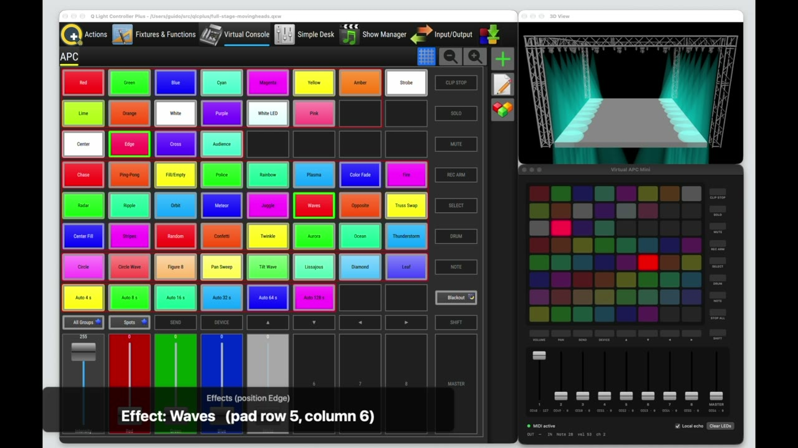
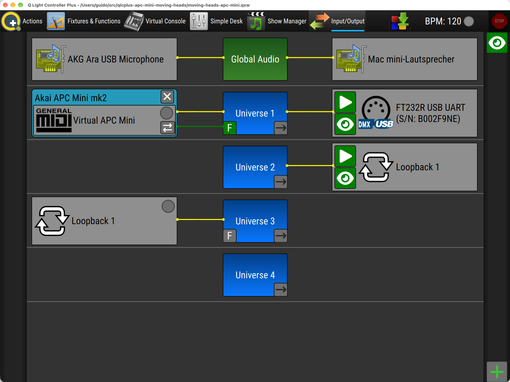

# QLC+ 5 Moving Head Demo With Optional External MIDI Controller

A demo workspace for [QLC+ 5](https://www.qlcplus.org/) that drives **32 moving heads** on four trusses (8 heads per truss). The show is shown in the QLC+ 3D view, so no real lights are needed.

You can run everything from the QLC+ virtual console or from an **AKAI APC mini mk2** connected via USB. The console page has the same layout as the controller, and the controller's RGB pads show the current state.

In the demo video, a software emulator of the APC mini mk2 stands in for the hardware controller.

The project was partially created with the help of AI, including the background music of the video.

## Video

Watch the [demo on YouTube](https://www.youtube.com/watch?v=GnkUbPkxOSo) (5:53). On the left is the QLC+ virtual console, on the right the 3D view and the APC mini mk2 emulator. Captions show which program is running.

## Requirements

- QLC+ 5 (tested with 5.3.0, see [known issue](#known-issue-no-microphone-access-on-macos-qlc-530))
- An audio input (microphone or line in) for the beat-synced effects
- Optional: AKAI APC mini mk2 (the first-generation APC mini has no RGB pads, so its feedback colors won't match)

The workspace only uses resources that ship with QLC+:

- Fixture: beamZ *MHL-74 Wash 7x10W 4in1 RGBW* (12-channel mode)
- Input profile: *Akai APC Mini mk2*

## Getting started

1. Open `moving-heads-apc-mini.qxw` in QLC+. The workspace starts in the virtual console.
2. To see the stage, go to **Fixtures & Functions** and click **3D View**. A left click opens the view inside the main window, and a right click opens it in a separate window. The separate window lets you watch the stage and the virtual console side by side.
3. Optional: connect the APC mini mk2 and adjust the input/output settings (see below).
4. Under **Input/Output**, set the DMX output to your own interface. If you only want to use the 3D view, you don't need a DMX output.

## Input/Output settings

All 32 moving heads are patched to **Universe 1** (12 channels each, DMX 1–384).

**Universe 1, input:**

- Plugin: MIDI
- Device: the APC mini mk2 (named *Virtual APC Mini* in the screenshot, which is the software emulator used in the video)
- Profile: **Akai APC Mini mk2**
- Feedback: enabled (the ⇄ button on the input and the green **F** on the universe). QLC+ then sends the pad colors back to the controller.

The workspace was saved with the emulator as input device. With a real controller, select its MIDI port instead and keep the profile and feedback settings.

**Universe 1, output:**

- Plugin: DMX USB, in the screenshot an FT232R-based USB-DMX interface
- Output enabled (▶)

Select your own DMX interface here, or remove the output if you only use the 3D view.

**Universes 2–4:** The loopback between Universe 2 and Universe 3 was created by the QLC+ wizard. The project doesn't use it, so you can ignore or remove it.

**Audio:** In the top row, *Global Audio* uses the microphone as input. The beat-synced effects need it (see [Audio beat sync](#audio-beat-sync)).

Command line start (macOS, recommended because of the [microphone issue](#known-issue-no-microphone-access-on-macos-qlc-530)):

    /Applications/QLC+.app/Contents/MacOS/qlcplus5 -o moving-heads-apc-mini.qxw

## Controller layout

The pads are counted from top to bottom, as on the device:

| Pad row | MIDI notes | Function |
|---|---|---|
| 1 | 56–63 | Colors: Red, Green, Blue, Cyan, Magenta, Yellow, Amber, **Strobe** |
| 2 | 48–55 | Colors: Lime, Orange, White, Purple, White LED, Pink |
| 3 | 40–43 | Positions: Center, Edge, Cross, Audience |
| 4–6 | 16–39 | Light effects (chase, ping-pong, police, rainbow, plasma, fire, radar, meteor, waves, aurora, thunderstorm, …) |
| 7 | 8–15 | Movement: Circle, Circle Wave, Figure 8, Pan Sweep, Tilt Wave, Lissajous, Diamond, Leaf |
| 8 | 0–5 | Auto shows that switch every 4, 8, 16, 32, 64 or 128 s |
| Right column | 112–119 | Scene buttons, the last one is **Blackout** |
| Faders | CC 48–56 | Intensity and color mix (Red, Green, Blue, White) |

Each group is a solo frame, so pressing a pad replaces the active program of that group. Groups combine with each other: you can run a color, a position, an effect and a movement at the same time.

The movement effects are relative, so they move around whichever position is active.

## Audio beat sync

The workspace uses QLC+'s audio beat detection: the beat generator is set to *Audio*, so the tempo comes from the audio input (e.g. the microphone). These 12 effects are timed in beats, so they only advance while QLC+ detects beats:

Chase, Ping-Pong, Fill/Empty, Police, Rainbow, Color Fade, Waves, Opposite, Truss Swap, Center Fill, Stripes, Random

All other effects, the movements and the auto shows run on fixed times.

### Known issue: no microphone access on macOS (QLC+ 5.3.0)

The macOS app bundle of QLC+ 5.3.0 has no `CFBundleIdentifier`, so macOS never asks for microphone permission and QLC+ only receives silence. The level meter stays empty and the beat-timed effects don't move.

Workaround: start QLC+ from the Terminal. It then uses the Terminal's microphone permission:

    /Applications/QLC+.app/Contents/MacOS/qlcplus5 -o moving-heads-apc-mini.qxw

If macOS asks whether Terminal may use the microphone, allow it. Alternatively, enable it under **System Settings → Privacy & Security → Microphone**.

A separate wrapper app with its own microphone permission didn't work in our tests.

## Files

| File | Description |
|---|---|
| `moving-heads-apc-mini.qxw` | The QLC+ workspace |
| `docs/video-preview.jpg` | Preview image for the video |
| `docs/input-output.png` | Screenshot of the Input/Output settings |
| `LICENSE` | MIT License |

## License

Released under the [MIT License](LICENSE).
